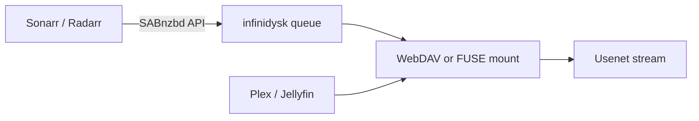

import { Aside, Badge, Card, CardGrid, LinkButton } from '@astrojs/starlight/components';

infinidysk is a Usenet-backed virtual filesystem. A **SABnzbd-compatible API** lets Sonarr, Radarr and other Arr instances use it as a download client, and your media server plays files straight from your Usenet providers, without storing them on disk.

## Pick your version

Two versions are supported side by side for now. Use the docs for the version you run.

<CardGrid>
	<Card title="1.x" icon="approve-check">
		<Badge text="Stable" variant="success" /> The current release, written in C#. Mounts through an rclone sidecar over WebDAV. Has the full feature set, including Stremio, search and backups.

		Image: `ghcr.io/infinidysk/infinidysk`

		<LinkButton href="/v1/">1.x docs</LinkButton>
	</Card>
	<Card title="2.x" icon="rocket">
		<Badge text="Alpha" variant="caution" /> The Rust rewrite, for early testers. Built-in FUSE mount, lower CPU and memory use, and a one-step upgrade from a 1.x config.

		Image: `ghcr.io/infinidysk/infinidysk-next`

		<LinkButton href="/v2/">2.x docs</LinkButton>
	</Card>
</CardGrid>

<Aside title="Which version am I running?">
Check the image in your compose file. `ghcr.io/infinidysk/infinidysk` is 1.x. `ghcr.io/infinidysk/infinidysk-next` is 2.x.
</Aside>

## How the versions compare

Both versions speak the same SABnzbd API and serve the same WebDAV paths, so Arrs and media servers see no difference. What sits behind them differs.

| | 1.x | 2.x |
|---|---|---|
| SABnzbd API for Arrs | Yes | Yes |
| WebDAV | Yes | Yes |
| Mount | rclone sidecar | Built-in FUSE |
| Symlink and STRM imports | Yes | Yes |
| Health checks and Arr replacement | Yes | Yes |
| PAR2 repair | Yes | Not yet |
| Multiple providers with priority levels | Yes | Yes |
| Provider catalog with backbones | No | Yes |
| Download speed limit | Yes | Yes |
| Global connection cap | Yes | Not yet |
| Disk segment cache | Yes | Yes |
| SQLite and PostgreSQL | Yes | Yes |
| Prometheus metrics | Yes | Yes |
| Stremio and addon routes | Yes | Not yet |
| Search, indexers and Prowlarr | Yes | Not yet |
| Backup and restore | Yes | Not yet |
| Watchtower, Preflight and Warden | Yes | No |
| Imports a 1.x config | — | Yes |

### Performance

| Measure | 1.x | 2.x |
|---|---|---|
| Startup | 6.2 s | 0.4–0.5 s |
| CPU time per GB streamed | 13.2–13.3 s | 3.7–4.1 s |
| Memory at idle | 165–302 MB | 68–70 MB |
| Memory per stream | 1.28–1.53 GB | 1.14–1.26 GB |
| Sequential throughput | 103–111 MB/s | 92–103 MB/s, on par within run-to-run variance |
| Rebuffers at a 3.1 MB/s playback rate | 0 of 5 | 0 of 5 |

<small>
Measured on 27 October 2026 with 1.6.3 and 2.0.0-alpha.8 in Docker on one Apple M4 Pro host, one commercial provider with 20 connections, five posts with a median size of 10.7 GB, three passes. Ranges span the three passes.
</small>

## Community

Chat on Discord and follow releases. After joining, use the channel and role selector to enable release notifications.

<LinkButton href="https://discord.gg/DAya7W6QMa" icon="discord" iconPlacement="start">Join Discord</LinkButton>
<LinkButton href="https://github.com/infinidysk/infinidysk/releases" variant="secondary">1.x releases</LinkButton>
