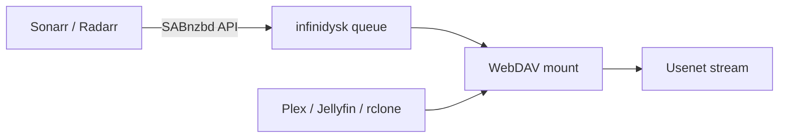

import { CardGrid, LinkButton, LinkCard, Tabs, TabItem } from '@astrojs/starlight/components';

<div class="badges">

[](https://github.com/infinidysk/infinidysk/releases)
[](https://github.com/infinidysk/infinidysk/pkgs/container/infinidysk)
[](https://github.com/infinidysk/infinidysk/actions)
[](https://github.com/infinidysk/infinidysk/blob/main/LICENSE)

</div>

infinidysk is a **WebDAV server** that mounts NZB documents as a browsable virtual filesystem. Content streams on demand from your Usenet provider. A **SABnzbd-compatible API** lets Sonarr, Radarr and other Arr instances use it as a drop-in download client, so you can build an effectively infinite media library without storing full files on disk.



## Why infinidysk

<CardGrid>
	<LinkCard title="Virtual filesystem" description="Browse NZB contents instantly over WebDAV. No full download before you open a file." href="/features/webdav-filesystem/" />
	<LinkCard title="Stream and seek" description="Jump anywhere in a video. Optional NNTP pipelining for higher throughput and faster seeks." href="/features/streaming-seeking/" />
	<LinkCard title="Arr compatible" description="SABnzbd API for Sonarr and Radarr, with symlink or STRM import strategies." href="/use-cases/infinite-library-arr/" />
	<LinkCard title="Multi-provider" description="Cascade routing, circuit breakers, data caps and automatic failover across providers." href="/features/multi-provider/" />
</CardGrid>

## How infinidysk compares

Choosing between streaming WebDAV tools and classic download clients depends on your media server, disk budget, and how much operations work you want.

<LinkCard title="Compare alternatives" description="infinidysk vs AltMount vs classic SABnzbd/NZBGet: feature table and audience guidance." href="/guides/compare/" />

## Quick start

<Tabs>
<TabItem label="Docker run">

```bash
docker run --rm -it -p 3000:3000 ghcr.io/infinidysk/infinidysk:latest
```

Ephemeral trial: settings are discarded when the container exits.

</TabItem>
<TabItem label="Docker Compose">

```yaml
services:
  nzbdav:
    image: ghcr.io/infinidysk/infinidysk:latest
    container_name: nzbdav
    restart: unless-stopped
    ports:
      - "3000:3000"
    environment:
      PUID: "1000"
      PGID: "1000"
      TZ: Etc/UTC
    volumes:
      - ./config:/config
```

</TabItem>
<TabItem label="DUMB stack">

infinidysk is a supported core module in [Debrid Unlimited Media Bridge (DUMB)](https://dumbarr.com/). Enable infinidysk during DUMB onboarding (or set Arr `core_service` to include `nzbdav`) for guided Usenet WebDAV and download-client wiring.

<LinkButton href="https://dumbarr.com/services/core/nzbdav/" variant="secondary">infinidysk on dumbarr.com</LinkButton>
<LinkButton href="/getting-started/#setup-and-hosting-options" variant="minimal">Hosting options</LinkButton>

</TabItem>
</Tabs>

Then open `http://localhost:3000` (self-hosted) or your DUMB service URL, create your admin account if needed, and add a Usenet provider under Settings.

:::caution[Expose carefully]
Port `3000` is plain HTTP. Put infinidysk behind HTTPS for remote access. WebDAV uses Basic auth, so TLS matters. Prefer binding `127.0.0.1:3000:3000` when a reverse proxy runs on the host.
:::

<LinkButton href="/getting-started/docker/">Full Docker guide</LinkButton>
<LinkButton href="/getting-started/migration/" variant="secondary">Migrate from another build</LinkButton>
<LinkButton href="/getting-started/first-run/" variant="minimal">First-run checklist</LinkButton>

## Documentation

<CardGrid>
	<LinkCard title="Getting started" description="Install with Docker, complete first-run setup, connect Radarr and Sonarr." href="/getting-started/" />
	<LinkCard title="Guides" description="Architecture, import strategies, rclone mounts, media servers, Stremio, troubleshooting." href="/guides/architecture/" />
	<LinkCard title="Configuration" description="What every Settings control does, plus the headless NZBDAV_CONFIG__ schema." href="/configuration/" />
	<LinkCard title="Use cases" description="Infinite library with Arrs, streaming-only setups, multi-provider failover." href="/use-cases/" />
</CardGrid>

## Community

Chat on Discord, track releases on GitHub, and file issues when you need a durable bug report.

After joining Discord, use the channel and role selector to enable **infinidysk - SuperFork** for release notifications and development channels.

<LinkButton href="https://discord.gg/DAya7W6QMa" icon="discord" iconPlacement="start">Join Discord</LinkButton>
<LinkButton href="https://github.com/infinidysk/infinidysk" variant="secondary">Repository</LinkButton>
<LinkButton href="https://github.com/infinidysk/infinidysk/releases" variant="minimal">Releases</LinkButton>
