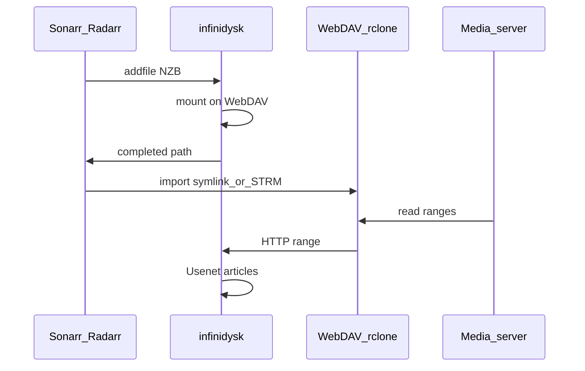

Opinionated production path for maximum “always available” library feel with minimal local storage.

## Checklist

1. [Docker deploy](/getting-started/docker/) with `/config` and shared `/mnt` (or equivalent).
2. [First run](/getting-started/first-run/) — providers, WebDAV, API key.
3. Pick [import strategy](/guides/import-strategies/):
   - Plex → symlinks + [rclone mount](/guides/mounting-webdav/)
   - Emby/Jellyfin → STRM + Base URL
4. [Connect Radarr/Sonarr](/getting-started/connect-arr/) as SAB client + register instances in infinidysk.
5. Enable [Repairs](/configuration/repairs/) with **Library Directory**.
6. Optional: [Watchtower](/features/watchtower/), indexer [profiles](/configuration/profiles/), [backups](/guides/backups-upgrades/).

## Operations

- Retention and orphan cleanup — [Operations](/operations/retention-cleanup/)
- Deletion surprises — [Deletion audit](/operations/deletion-audit/)
- Speed tuning — Max Download Connections on [WebDAV](/configuration/webdav/)
