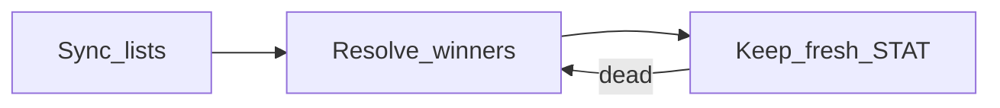

Watchtower keeps titles on your lists **ready**: each is pre-resolved to a healthy release and re-verified over time, ahead of demand. By default it picks the same release Watchdog would (**Match the watchdog's pick**); **Largest healthy release** is the alternative.

**Pointer-only.** Resolving fetches candidate NZBs, verifies them, and keeps the winner's NZB plus a shortlist of backups. It does not download the video; nothing streams until playback is requested.

## Loops

1. **Sync**: enumerate enabled sources into a deduplicated wanted set.
2. **Resolve**: search, filter by size and grabs, fetch candidate NZBs, STAT-verify, and keep a shortlist. Bounded by the warm-set cap and by the daily resolve budget, unless **Auto throughput** is enabled (then indexer limits set the pace).
3. **Keep-fresh**: re-STAT winners without grabbing; promote backups or re-resolve.

## Sources

- Manual IMDb ids on the Watchtower page
- Stremio catalog URLs
- URL lists (JSON or newline ids)
- Whole series (expanded via TVmaze / Kitsu where supported)

## Safety

Reuses indexer hit trackers and rate limiters. Off until enabled, with conservative defaults. Configure under [Watchtower settings](/v1/configuration/watchtower/).

## Status notes

Movies, episodes, and series expansion are supported for common id namespaces; some catalog ids are accepted but not yet expanded. Cross-namespace dedup is a follow-up.
