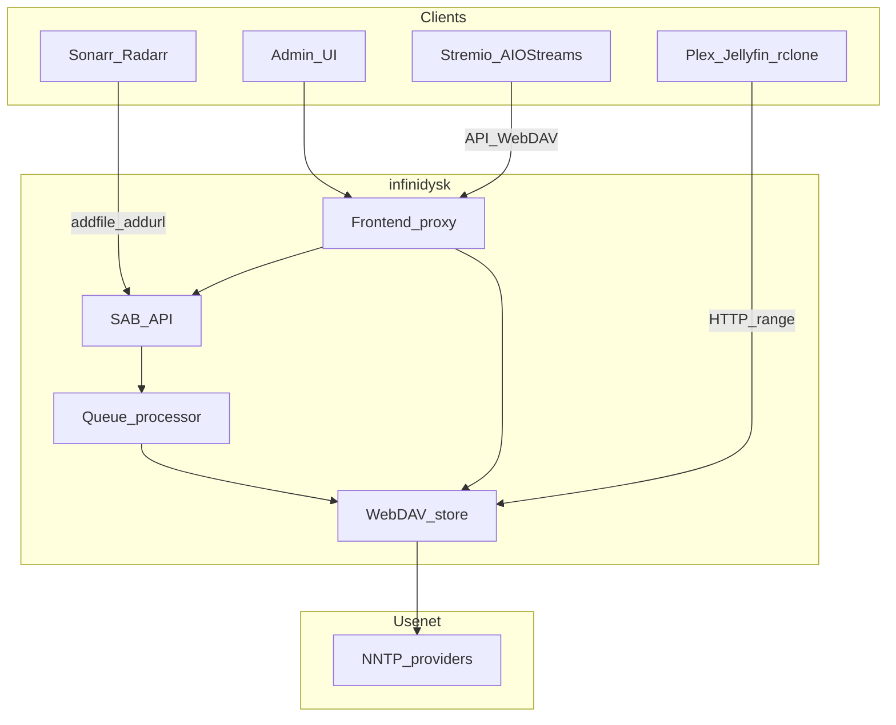

infinidysk sits between download clients / search and Usenet providers, exposing a virtual filesystem and SAB-compatible API.

## Two common flows

### Automation (Arr + media server) {#automation-arr-media-server}

1. Radarr or Sonarr sends an NZB to infinidysk as a SABnzbd download client.
2. infinidysk mounts the release on WebDAV without downloading the full file.
3. It creates an import entry:
   - **Symlinks**: entries under `/completed-symlinks`; rclone turns them into filesystem links into `/.ids`.
   - **STRM**: small `.strm` files with authenticated streaming URLs.
4. The Arr app imports into the library; the media server reads through the link or URL → infinidysk → Usenet.

### On-demand (Stremio)

There are two Stremio paths:

**Direct Search Profile preset** <a class="since" href="https://github.com/infinidysk/infinidysk/releases/tag/v1.3.0">since 1.3.0</a>

1. infinidysk searches the profile's Newznab indexers and returns playable stream objects.
2. AIOStreams or Stremio lists those streams. The dedicated infinidysk preset can report the
   final order back to `/adapters/addon/{profile-token}/failover_order`.
3. Playback hits `/adapters/addon/{profile-token}/play/{play-token}.mkv`, which resolves and
   queues the NZB, then redirects to `/view`.

**AIOStreams-managed search**

1. AIOStreams finds a release via its own Newznab addons.
2. The NZB is mounted through infinidysk's service/API.
3. Playback URL (often proxied by AIOStreams) streams from WebDAV.

## Processes and ports

| Process | What it does |
|---|---|
| Frontend | Admin UI, auth, proxy for WebDAV, `/api`, and `/ws`. Default `:3000`. |
| Backend | WebDAV, queue, SAB API. Default `:8080` (internal). |

The main database is SQLite under `CONFIG_PATH` by default; set `DATABASE_PROVIDER=postgres`
to use PostgreSQL instead.

Backend services such as rclone should connect to WebDAV on port `8080`. The frontend
WebDAV proxy is a fallback for clients that cannot reach the backend and adds streaming
overhead.

Persistent state lives under `/config` (database, settings, blobs, backups).

## Related

[Import strategies](/v1/guides/import-strategies/) · [Setup guide](/v1/getting-started/setup-guide/) · [Environment variables](/v1/configuration/environment-variables/) · [Code boundaries](https://github.com/infinidysk/infinidysk/blob/main/docs/decisions/0001-code-boundaries.md)
