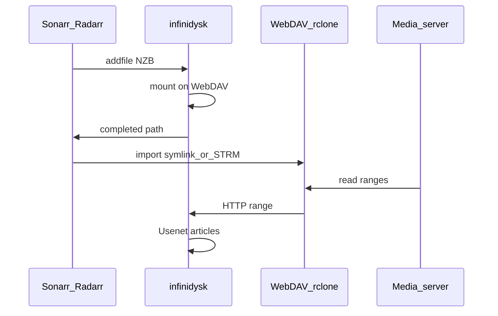

Opinionated production path for an always-available library with minimal local storage.

## Checklist

1. [Docker deploy](/v1/getting-started/docker/) with `/config` and shared `/mnt` (or equivalent).
2. [First run](/v1/getting-started/first-run/): providers, WebDAV, API key.
3. Pick an [import strategy](/v1/guides/import-strategies/):
   - Plex: symlinks + [rclone mount](/v1/guides/mounting-webdav/)
   - Emby/Jellyfin: STRM + Base URL
4. [Connect Radarr and Sonarr](/v1/getting-started/connect-arr/) as SAB download clients and register the instances in infinidysk.
5. Enable [Repairs](/v1/configuration/repairs/) with **Library Directory**.
6. Optional: [Watchtower](/v1/features/watchtower/), indexer [profiles](/v1/configuration/profiles/), [backups](/v1/guides/backups-upgrades/).

## Operations

- Retention and unlinked-file cleanup: [Retention and cleanup](/v1/operations/retention-cleanup/)
- Deletion surprises: [Deletion audit](/v1/operations/deletion-audit/)
- Speed tuning: Max Download Connections under **Settings → Streaming** ([Streaming settings](/v1/configuration/streaming/))

## Next

[Import strategies](/v1/guides/import-strategies/)
